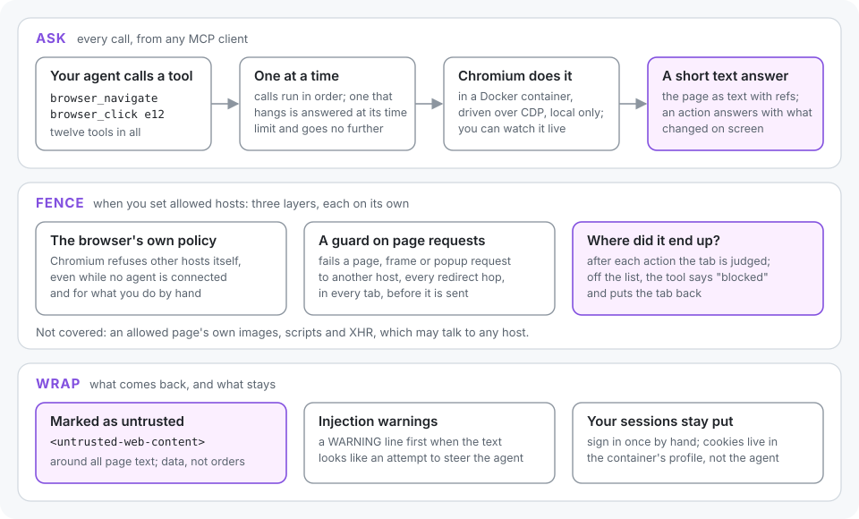

<p align="center">
  
</p>

<h1 align="center">sandboxed-browser-mcp</h1>

<p align="center">
  <b>A real browser for your agent, fenced to the sites you allow.</b><br>
  Claude Code, Codex and pi drive a Chromium that runs in Docker, read pages as short text,<br>
  and stay on the hosts you list, while your logins stay in the container.
</p>

<p align="center">
  <a href="https://github.com/smkamranqadri/sandboxed-browser-mcp/actions/workflows/ci.yml"></a>
  <a href="LICENSE"></a>
  
  
  
</p>

You ask your agent to read the docs of a new API, check a page you just deployed, or fill in a form.
It needs a browser. A browser holds your logins and can reach anything, and the pages it reads can
try to give your agent orders.

sandboxed-browser-mcp is an MCP server with twelve browser tools. They drive Chromium inside a Docker
container, answer with the page as short text a model can use, and, when you list allowed hosts,
keep the browser on them: the browser's own policy, a guard on every page request and a check after
every action each refuse the rest. Everything read from a page comes back marked as untrusted.

<p align="center">
  
</p>

## Contributing

The most useful help right now:

- Try it with your agent and [open an issue](https://github.com/smkamranqadri/sandboxed-browser-mcp/issues) for
  anything that surprised you: a page the tools read badly, an action that missed, a host the fence let through.
- Add a client: if your MCP client needs a different command or setting, a note in
  [Configuration](docs/configuration.md#add-it-to-a-client) helps the next person.
- Tighten the fence: a way past the allowlist for something it says it covers, with a test that shows it.

Read [CONTRIBUTING.md](CONTRIBUTING.md) before your first pull request.

More detail: [How it works](docs/how-it-works.md) · [Configuration](docs/configuration.md) ·
[Security](docs/security.md) · [Testing](docs/testing.md) · [FAQ](#faq) · [Changelog](CHANGELOG.md)

## Quick start

```sh
curl -fsSL https://raw.githubusercontent.com/smkamranqadri/sandboxed-browser-mcp/main/install.sh \
  | bash -s -- install --client claude --hosts 'docs.example.com,*.example.org'
```

This builds the newest release in `~/.local/share/sandboxed-browser-mcp`, starts the browser in Docker, and adds it
to Claude Code as `browser` (`--client codex` and `--client pi` work too; list several with commas). Leave out
`--hosts` to allow any host. Then open `https://127.0.0.1:3101` (user `agent`, password in the install's
`docker/.env`) and sign in to the sites you want the agent to use, or leave it signed out.

Requirements: Linux, git, Node 22.4 or later, Docker with Compose. macOS and Windows are untested. To set it up by
hand instead, see [Configuration](docs/configuration.md#manual-setup).

## What you get

- A real Chromium, in a container. It keeps its own profile, so the agent browses with the sessions you signed in to,
  and you can watch it, or take over, in a web page at `https://127.0.0.1:3101`.
- Answers sized for a model. A page is its viewport as text, one line per element with a ref to act on. A click or a
  typed field answers with what changed on screen, not the whole page again.
- Twelve tools: `browser_navigate`, `browser_back`, `browser_snapshot`, `browser_click`, `browser_type`,
  `browser_select`, `browser_key`, `browser_scroll`, `browser_find`, `browser_get_text`, `browser_screenshot`,
  `browser_upload`.
- File upload from your machine: `browser_upload` gives a page's file input files from under your home folder,
  through the input, its label or the button that opens its chooser, with no file dialog and no folder shared with the
  container.
- A fence, when you want one. List the hosts the agent may use, and three layers each refuse the rest: the browser's
  own policy, a guard on every page request, and a check of where every action ended up.
- Page text marked as untrusted, every time, with a warning line when it looks like an attempt to steer the agent.
- One command to install, check for updates, update and uninstall.

## Supported agents

| Agent | Added with | Notes |
| --- | --- | --- |
| Claude Code | `claude mcp add -s user browser …` | in every project |
| Codex | `codex mcp add browser …` | asks before each tool call; may prefer its own browser (below) |
| pi | `pi mcp add browser --exposure direct …` | lists the twelve tools as they are |

The install script runs these for you with `--client`. Any other MCP client works too: it runs
`node <install dir>/dist/server.js` over stdio. Each was checked with one real session; see
[Testing](docs/testing.md#not-verified).

Codex has a browser of its own, and its model may reach for that one instead: name this one in the prompt ("use the
browser MCP server") when it matters. To let its calls run without asking, add to `~/.codex/config.toml`:

```toml
[mcp_servers.browser]
default_tools_approval_mode = "approve"
```

## Everyday use

Ask for what you want; the agent picks the tools:

```text
Open docs.example.com and find how to rotate an API key.
Check the pricing page on our staging site and tell me if the new plan shows.
Fill in the signup form on example.org with these details, but stop before you submit.
Attach ~/Documents/seed-list.csv to the import form.
```

- Watch it work, or take over, at `https://127.0.0.1:3101`. An arrow shows where the agent is about to click.
- Change the allowed hosts in two places: the install's `docker/.env` (then
  `docker compose -f <install dir>/docker/compose.yaml up -d`) and the client's entry. See [Configuration](docs/configuration.md#allowed-hosts).
- `install.sh check` and `install.sh update` keep you current; `install.sh uninstall` removes it, and `--purge` also
  deletes the browser profile with your sessions.

## Privacy and safety

- Everything runs on your machine. The browser's ports are bound to `127.0.0.1`.
- Your passwords and cookies stay in the container's profile. The agent gets page text and screenshots, not cookies.
- The fence is a filter, not a wall: an allowed page's own images, scripts and requests may reach any host, and the
  container has ordinary network access. Keep the list tight, and keep accounts you cannot afford to lose out of the
  profile.
- Uploads read files from your machine: only regular files under your home folder, never credential, key, history or
  browser-profile files (a denylist), and the page then has their bytes and can send them anywhere. Linux only.
- Anything on your machine that can reach `127.0.0.1:9322` can drive the browser.

The full threat model, with what is and is not covered: [Security](docs/security.md).

## FAQ

**Does the agent see my passwords?** No. You sign in by hand in the browser; the agent works in the signed-in pages and
gets their text, but the tools do not return cookies or stored passwords. A page itself can still show the agent
whatever it shows you.

**Why Docker?** The browser keeps its own profile, apart from the one you use every day, and you can delete it with one
command. The container is not a network sandbox, though; see [Security](docs/security.md).

**Can I use my own Chrome instead?** Yes: point `BROWSER_CDP_URL` at any Chrome with remote debugging on. See
[Configuration](docs/configuration.md#using-another-chrome) for the flag it needs and what you give up.

**Why does the agent say a page is "not an allowed host" before it has done anything?** A fresh browser opens on its
new-tab page, which is not on your list. Ask the agent to open an address first.

**Is the allowlist a security boundary?** No. It keeps a well-meaning agent where you want it and makes a tricked one
much less useful, but an allowed page can still talk to other hosts. See [Security](docs/security.md).

**How do I undo it?** `install.sh uninstall --purge` stops the browser, removes the client entries it added and deletes
the install and the browser profile.

## Development

```sh
git clone https://github.com/smkamranqadri/sandboxed-browser-mcp.git && cd sandboxed-browser-mcp
npm ci
npm run test:unit                          # no browser needed
./install.sh install --source . --dir /tmp/sbm-dev   # install your working copy
```

The integration tests drive a real Chromium in a separate test stack; see [Testing](docs/testing.md). This
repository also carries its own project memory in `kis/`.

## License

[MIT](LICENSE)
